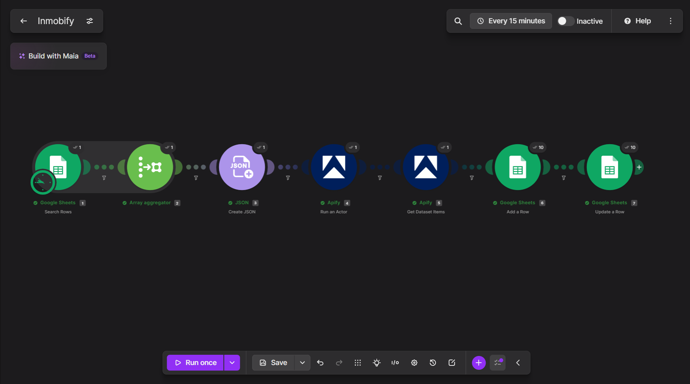

# 🔮 Inmobify Inference — Motor Predictivo y Tasador Comercial Automatizado (Rosario)

**Samsung Innovation Campus (SIC) — Capstone Project | Entrega 2: Machine Learning & Inferencia en Producción**

---

## 👥 Equipo de Trabajo

- **Nombre del Grupo:** Ex UM
- **Nombre del Proyecto:** Inmobify — Pipeline Automatizado de Datos Inmobiliarios y Entorno Comercial en Rosario
- **Integrantes:**
  - Francisco Lovatti
  - Matias Radice

---

## 🔗 Recursos Asociados (Producción y Entregables)

| Recurso | Descripción | Enlace |
| :--- | :--- | :--- |
| **Dashboard Interactivo** | Aplicación web en Streamlit Cloud con Tasador Predictivo en vivo (Individual y Lote CSV) | [Inmobify.streamlit.app](https://inmobify.streamlit.app) |
| **Orquestación de Tasaciones (Make)** | Escenario automatizado (`Google Sheets` $\rightarrow$ `Apify` $\rightarrow$ `Google Sheets`) | [Make/Inmobify-inference](https://us2.make.com/public/shared-scenario/yk6QatPM1JQ/inmobify) |
| **Planilla Operativa (Google Sheets)** | Hojas `Consultas` (entrada de propiedades) y `Tasaciones` (historial acumulado) | [Carpeta inferencia](https://drive.google.com/drive/folders/1mdFoXO3rzHIpRN7NYhM9m44incE72Dtb?usp=drive_link) |
| **Actor de Preprocessing (Entrega 1)** | Repositorio del pipeline ETL, Feature Engineering Haversine y EDA | [franlovatti/inmobify-preprocessing](https://github.com/franlovatti/inmobify-preprocessing) |

<p align="center"></p>

---

## ⚙️ Arquitectura del Pipeline de Inferencia End-to-End

El servicio de inferencia conecta **Google Sheets**, **Make**, **Apify** y **Streamlit** permitiendo tasar propiedades de forma individual o masiva en una única corrida serverless:

```text
[Google Sheets: Hoja 'Consultas' (estado vacío)]   ó   [Streamlit: Tasador Individual / Lote CSV]
            │                                                       │
            ▼  (Make: Search Rows -> Array Aggregator -> JSON)      │ (apify-client SDK)
[Apify Actor: inmobify2/inmobify] ◄─────────────────────────────────┘
  ├── 1. Verificación de integridad SHA-256 y carga segura de modelo (.pkl)
  ├── 2. Resolución geográfica en 3 niveles (Geocodificación dirección / Centroide barrio / Coordenadas)
  ├── 3. Enriquecimiento Haversine en vivo contra maestro_comercios_rosario.csv (200m + polos)
  └── 4. Predicción del canon mensual (USD), USD/m² y diagnóstico de mercado
            │
            ├──────────────────────────────────────────┐
            ▼                                          ▼
[Apify Default Dataset & KV Store]          [Make: Get Dataset Items]
  └── Consumo en vivo en Streamlit Cloud      ├── Add a Row -> Hoja 'Tasaciones' (historial)
                                              └── Update a Row -> Hoja 'Consultas' (estado = PROCESADO)

```

---

## 🧠 Modelado Predictivo, Resolución Geográfica y Métricas

### 1. Catálogo de Modelos Entrenados (11 Estimadores Serializados)

El Actor empaqueta en `modelos_entrenados/` los **11 modelos entrenados** sobre el dataset curado de Rosario (`477` propiedades comerciales), validados mediante validación cruzada (`5-Fold CV`) y conjunto de prueba (`Test 20%`), con verificación criptográfica **SHA-256** antes de su deserialización segura (`model_defs.py`):

* **Modelo Recomendado por Defecto:** **`Ensamble Top-3`** (`VotingRegressor` compuesto por `Gradient Boosting`, `HuberRegressor` y `LightGBM` con transformación logarítmica `TransformedTargetRegressor` sobre `log1p(precio_usd)`).
* **Modelos Disponibles para Selección:** `Ensamble Top-3`, `Gradient Boosting`, `HuberRegressor`, `LightGBM`, `ElasticNet`, `Ridge`, `Lasso`, `XGBoost`, `SVR (RBF)`, `Random Forest` y `KNN Regressor`.

### 2. Resolución Geográfica Inteligente (Cero Fricción y Cero Contradicciones)

Para evitar que el usuario final tenga que buscar coordenadas manualmente o que se produzcan inconsistencias entre el barrio y la ubicación, `src/geo_features.py` resuelve cada propiedad en cascada:

1. **Coordenadas explícitas (`latitud`, `longitud`):** Si se proveen coordenadas válidas dentro de Rosario, las utiliza directamente y deduce el barrio más cercano por distancia Haversine.
2. **Geocodificación por dirección (`direccion`):** Si se ingresa calle y altura (ej. `"Bv. Oroño 850"` o `"Av. Pellegrini 1420"`), consulta **Google Maps Geocoding API** (si se configura `google_maps_api_key`) o **OpenStreetMap Nominatim** (gratuito, sin clave) y asigna automáticamente el barrio correspondiente.
3. **Centroide de barrio (`barrio`):** Si solo se informa el barrio, asigna las coordenadas de su centroide urbano en Rosario.

### 3. Salidas y Diagnóstico de Mercado

Por cada propiedad procesada, el Actor publica en el **Default Dataset** de Apify:

* **`precio_predicho_usd` y `precio_m2_predicho_usd`:** Alquiler mensual estimado en dólares y valor unitario por metro cuadrado.
* **`densidad_comercial_200m`, `diversidad_rubros_200m` y `dist_polo_mas_cercano_m`:** Métricas espaciales calculadas en vivo contra `maestro_comercios_rosario.csv` en `inmobify-storage`.
* **`diferencia_vs_publicado_pct` y `diagnostico_mercado`:**
* `Oportunidad (≥15% bajo tasación)` cuando el precio publicado es al menos 15 % inferior al valor estimado.
* `Precio de Mercado` cuando la diferencia se ubica dentro de $\pm 15\%$.
* `Sobrevaluado (≥15% sobre tasación)` cuando supera en 15 % o más la tasación del modelo.
* `Tasación de Referencia` cuando no se informa precio publicado.


---

## 📂 Estructura y Contenido del Repositorio

```text
inmobify-inference/
├── .actor/
│   ├── actor.json                  # Metadatos y configuración del Actor en Apify
│   └── input_schema.json           # Esquema de entrada (modo individual/lote, dirección, barrio, modelo)
├── modelos_entrenados/
│   ├── modelo_ensamble_top_3.pkl   # Modelo campeón empaquetado (VotingRegressor Top-3)
│   └── ... (10 modelos .pkl)       # Modelos individuales entrenados en scikit-learn / XGBoost / LightGBM
├── src/
│   ├── __init__.py                 # Inicialización del paquete fuente
│   ├── __main__.py                 # Soporte para ejecución como módulo (python -m src.main)
│   ├── main.py                     # Punto de entrada asíncrono del Actor (carga segura + inferencia + Dataset)
│   ├── geo_features.py             # Geocodificación, centroides de Rosario y cálculo Haversine a 200 m
│   ├── model_defs.py               # Definiciones de clases y Unpickler restringido con validación SHA-256
│   └── py.typed                    # Marcador de tipado estático PEP 561
├── .dockerignore                   # Exclusiones de build Docker
├── .gitignore                      # Exclusiones de control de versiones (storage/, .env, etc.)
├── Dockerfile                      # Imagen Python 3.11 + libgomp1 para soporte nativo de LightGBM
├── modelos_ranking_meta.json       # Registro de modelos disponibles, métricas CV/Test y hashes SHA-256
├── requirements.txt                # Dependencias (apify, pandas, numpy, scikit-learn==1.6.1, xgboost, lightgbm, requests)
└── README.md                       # Documentación técnica del Actor de inferencia

```

---

## 🚀 Ejecución Local y Pruebas

### 1. Prueba local mediante Python o Apify CLI

Creá un archivo `storage/key_value_stores/default/INPUT.json` con una consulta individual o en lote:

```json
{
  "kv_store_name": "inmobify-storage",
  "modelo_elegido": "Ensamble Top-3",
  "modo_ejecucion": "individual",
  "direccion": "Bv. Oroño 850",
  "tipo_inmueble": "Local comercial",
  "superficie_m2": 75,
  "tiene_expensas": 1,
  "precio_publicado_usd": 620
}

```

Ejecutá el Actor localmente:

```bash
pip install -r requirements.txt
export APIFY_TOKEN="apify_api_tu_token"
python -m src.main

```

Los resultados generados se almacenan en `storage/datasets/default/000000001.json`.
